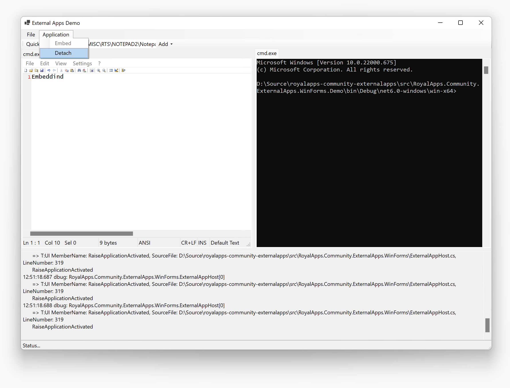

# External Apps Control

[](https://www.nuget.org/packages/RoyalApps.Community.ExternalApps.WinForms)
[](https://www.nuget.org/packages/RoyalApps.Community.ExternalApps.WinForms)
[](https://dotnet.microsoft.com/download)

RoyalApps.Community.ExternalApps contains projects/packages to easily embed/use other external applications in an application.


The ExternalAppHost control starts the configured process and embeds the application window into the control.

> **Warning**
> What this control does is not exactly a Microsoft supported scenario! Please read [Raymond Chen's blog post 'Is it legal to have a cross-process parent/child or owner/owned window relationship?'](https://devblogs.microsoft.com/oldnewthing/20130412-00/?p=4683) for more details. **Spoiler alert:** Yes, it's technically *legal*. It's also technically *legal* to [juggle chainsaws](https://www.youtube.com/watch?v=ti3MkTt5qv4)!

## Getting Started
### Installation
You should install the RoyalApps.Community.ExternalApps.WinForms with NuGet:
```
Install-Package RoyalApps.Community.ExternalApps.WinForms
```
or via the command line interface:
```
dotnet add package RoyalApps.Community.ExternalApps.WinForms
```
### Using the ExternalAppHost
#### Add Control
Place the `ExternalAppHost` on a form or in a container control (user control, tab control, etc.) and set the `Dock` property to `DockStyle.Fill`

#### Configuration
Create an instance of the `ExternalAppConfiguration` class and set the `Executable` property to the full path and file name of the application you want to embed.

#### Start
Simply call:
```csharp
ExternalAppHost.Start(externalAppConfiguration);
```
to start and embed the application.

#### Close
To close the application, call:
```csharp
ExternalAppHost.CloseApplication();
```
Depending on the application, you may get a confirmation dialog in case there are unsaved changes. You can set the `ExternalAppConfiguration.KillOnClose` property to `true` to forcibly quit the application by killing the process.

> **Note**
> All processes which are started by the control will be closed/killed when the main application is closed or killed.

#### Detach Application Window
Once the application is started and embedded, you can detach the application window by calling:
```csharp
ExternalAppHost.DetachApplication();
```

#### Re-Embed Application Window
To re-embed a detached application window, simply call:
```
ExternalAppHost.EmbedApplication();
```

#### Show System Menu
Shows the app's system menu on the specified location:
```csharp
ExternalAppHost.ShowSystemMenu(Point location);
```

#### Subscribe to Events
* `ExternalAppHost.ApplicationStarted` is raised when the application has been started and embedded.
* `ExternalAppHost.ApplicationClosed` is raised when the application was closed or killed (even outside of the hosting application).
* `ExternalAppHost.ApplicationActivated` is raised when the application has been activated (received the input focus).
* `ExternalAppHost.WindowTitleChanged` is raised when the window title of application window has changed.

## Exploring the Demo Application
The demo application is quite simple. It has two tab controls (one left and one right) and a bottom panel for log output. Use the toolbar to enter an executable to embed. The **Add** drop down allows you to choose the left or the right tab control.

There are two embed-methods available:
* **Embed as Control:** Only the client area of the external app window is embedded (without the main menu). The limitation of this method is that some applications may look like they are not focused/active.
* **Embed as Window:** The whole window is embedded including the main menu (if available). The limitation of this method is that the ALT-TAB order may be incorrect.

In the **Application** menu you can detach and re-embed the active external application.

## WinEmbed.dll
This project includes a dll called WinEmbed.dll (in the /lib folder) which handles most of the Windows native stuff. You can find the C/C++ code in the /src/WinEmbed directory. To build this dll from source, you need Visual Studio 2022 or later and also the [WDK](https://docs.microsoft.com/en-us/windows-hardware/drivers/download-the-wdk) installed.

For the ARM64 build to compile, install the following tools using Visual Studio 2022 installer:
```
MSVC v143 - VS 2022 C++ ARM64 build tools (latest)
```

## Building and testing

Install the .NET 10 and .NET 11 SDKs on Windows, then run:

```powershell
dotnet build src/RoyalApps.Community.ExternalApps.slnx -c Release
dotnet test src/RoyalApps.Community.ExternalApps.WinForms.Tests/RoyalApps.Community.ExternalApps.WinForms.Tests.csproj -c Release --no-build
dotnet pack src/RoyalApps.Community.ExternalApps.WinForms/RoyalApps.Community.ExternalApps.WinForms.csproj -c Release --no-build -o artifacts
```

The library and demo target `net10.0-windows` and `net11.0-windows`. The package includes native libraries for x64 and ARM64.

## NuGet trusted publishing

The `publish.yml` workflow builds and tests pull requests. Pushes to `main` or `v1` also publish the package using GitHub OIDC and a short-lived NuGet API key.

Before the first publish, create a policy under your nuget.org account's **Trusted Publishing** settings:

| Setting | Value |
| --- | --- |
| Policy name | `royalapps-community-externalapps` (or another descriptive name) |
| Package owner | The NuGet user or organization that owns `RoyalApps.Community.ExternalApps.WinForms` |
| Repository owner | `royalapplications` |
| Repository | `royalapps-community-externalapps` |
| Workflow file | `publish.yml` (filename only) |
| Environment | Leave empty; this workflow does not use a GitHub environment |
| Package scope | `RoyalApps.Community.ExternalApps.WinForms` |
| Allowed operation | Push new versions of the existing package |

In the repository's **Settings → Secrets and variables → Actions → Variables**, add `NUGET_USER` with the personal nuget.org username of the account that created the policy. Use the profile name, rather than an email address or the package-owning organization name.

After a successful trusted publish, remove the old `NUGET_API_KEY` repository secret. Revoke the old API key on nuget.org once any other workflows using it have migrated. If NuGet marks the policy as temporarily active, complete the first publish within its activation window or reactivate it before publishing.

See the [NuGet trusted publishing documentation](https://learn.microsoft.com/en-us/nuget/nuget-org/trusted-publishing) for details.

## Acknowledgements
Special thanks to [Alex](https://github.com/rbmm) for helping out with all the native code challenges.
